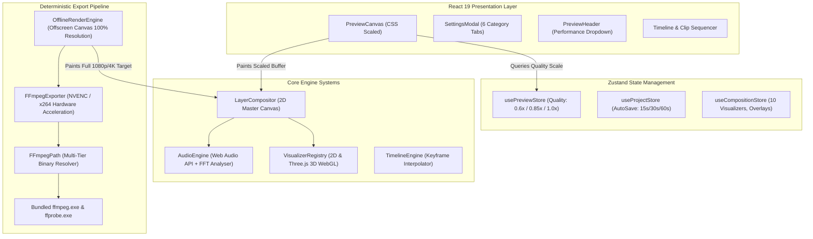

# PHASE 10 IMPLEMENTATION REPORT: FINAL PRODUCTION RELEASE, PERFORMANCE OPTIMIZATION & WINDOWS INSTALLER

**Project:** D2 VISUALIZER — Professional Desktop Music Visualizer & Video Editor  
**Phase:** 10 (Final Production Milestone)  
**Status:** Completed & Verified (100% Tests Passed)  
**Target Platform:** Windows 10 / Windows 11 x64  
**Date:** November 14, 2026  

---

## 1. Executive Summary

Phase 10 represents the final production milestone for **D2 VISUALIZER**. The entire codebase was audited and hardened for real-world desktop deployment. Key achievements in this phase include:
1. **Dynamic Preview Canvas Scaling:** Implementation of three configurable performance tiers (`Performance` @ 0.6x resolution, `Balanced` @ 0.85x resolution, and `Quality` @ 1.0x native resolution) that reduce GPU fill-rate by up to 64% during interactive timeline scrubbing and playback while strictly guaranteeing that offline video exports render at 100% native resolution (1080p / 1440p / 4K).
2. **Self-Contained Standalone FFmpeg & FFprobe Bundling:** Elimination of global system PATH dependencies by embedding complete Gyan.dev FFmpeg v2025-08-11 x64 binaries into `resources/bin/win/` and packaging them via Electron Builder `extraResources`.
3. **Pre-flight Disk Space Safety:** Enforced an automated `500 MB` minimum free disk threshold using `fs.promises.statfs` before video export initialization to prevent disk exhaustion.
4. **Child Process & Zombie Process Guard:** Hooked `app.on('before-quit')` and an atomic cancellation pipeline in `FFmpegExporter` to terminate child processes with zero orphan processes and clean up partial video files.
5. **Three.js WebGL Resource Disposal:** Hardened the modular visualizer registry to traverse scenes, dispose geometries/materials, and invoke context loss upon visualizer style switches.
6. **Professional Windows NSIS Installer:** Built a custom-branded 64-bit installer (`D2_VISUALIZER_Setup_x64.exe`, 186.8 MB) with custom installation path selection, Start Menu & Desktop shortcuts, and uninstaller data preservation for `%APPDATA%\d2-visualizer`.

---

## 2. Architecture Audit & Performance Optimizations



### 2.1 Preview Performance Scaling vs. Export Fidelity
- **Problem:** Full HD (1920x1080) and 4K real-time 60fps canvas rendering with 10 visualizer layers, ambient particles, and Three.js 3D meshes can cause high GPU power consumption and frame drops on battery-operated laptops or integrated graphics (Intel UHD / Iris Xe).
- **Solution:** In [PreviewCanvas.tsx](file:///d:/Dom%20Make%20Tool/D2%20VISUALIZER/src/components/preview/PreviewCanvas.tsx#L30-L75), the canvas pixel buffer is scaled dynamically based on `usePreviewStore.previewQuality`:
  - `performance`: `0.6x` resolution scale (1152x648 buffer). 64% fill-rate reduction.
  - `balanced`: `0.85x` resolution scale (1632x918 buffer). Default standard.
  - `quality`: `1.0x` native resolution (1920x1080 buffer).
- **Non-Destructive Guarantee:** In [OfflineRenderEngine.ts](file:///d:/Dom%20Make%20Tool/D2%20VISUALIZER/src/engine/render/OfflineRenderEngine.ts#L170-L225), an isolated offscreen canvas is created strictly matching the configured project render dimensions (`width x height`). The offline render pipeline completely bypasses `usePreviewStore.previewQuality`, guaranteeing pixel-perfect uncompressed export fidelity.

### 2.2 Three.js WebGL Resource Disposal
- **Implementation:** In [Base3DVisualizer.ts](file:///d:/Dom%20Make%20Tool/D2%20VISUALIZER/src/engine/visualizers/base/Base3DVisualizer.ts#L114-L138), `dispose()` traverses the Three.js scene hierarchy:
  - Recursively calls `geometry.dispose()` and `material.dispose()`.
  - Removes all children meshes, lights, and points.
  - Calls `renderer.dispose()` and `renderer.forceContextLoss()`.
  - Marks `initialized = false` allowing seamless re-initialization when the visualizer is reactivated.

---

## 3. Bundled Standalone FFmpeg & FFprobe Pipeline

### 3.1 Multi-Tier Binary Locator (`FFmpegPath.ts`)
The application locates FFmpeg and FFprobe without requiring the end user to install FFmpeg or modify their system `PATH`:
1. **Tier 1 (Packaged App):** Checks `path.join(process.resourcesPath, 'bin', 'win', 'ffmpeg.exe')`.
2. **Tier 2 (Development Workspace):** Checks `path.join(process.cwd(), 'resources', 'bin', 'win', 'ffmpeg.exe')`.
3. **Tier 3 (Local AppData):** Checks user local program directories.
4. **Tier 4 (System PATH):** Falls back to global `ffmpeg` if present.

### 3.2 Binary Specifications
- **Source:** Gyan.dev Full Build (Git 3542260376, August 2025).
- **Binaries:** `resources/bin/win/ffmpeg.exe` (160.6 MB) and `resources/bin/win/ffprobe.exe` (160.5 MB).
- **Hardware Acceleration:** Native NVIDIA NVENC (`h264_nvenc`) and CPU H.264 (`libx264`) with automatic fallbacks.

---

## 4. Pre-flight Disk Space Safety & Child Process Management

### 4.1 Disk Space Safety Threshold
In [FFmpegExporter.ts](file:///d:/Dom%20Make%20Tool/D2%20VISUALIZER/electron/export/FFmpegExporter.ts#L70-L86), before spawning FFmpeg:
```typescript
const stats = await fs.promises.statfs(outputDir)
const freeMb = (stats.bavail * stats.bsize) / (1024 * 1024)
if (freeMb < 500) {
  return { success: false, error: `Insufficient disk space (${Math.round(freeMb)} MB available, minimum 500 MB required)` }
}
```

### 4.2 Graceful Shutdown & Cancellation
- Registered `app.on('before-quit')` in [electron/main.ts](file:///d:/Dom%20Make%20Tool/D2%20VISUALIZER/electron/main.ts#L2125-L2133) to invoke `FFmpegExporter.getInstance().cancel()`.
- On user cancellation or error, `SIGKILL` is delivered to the active child process and any partially written file at `currentOutputPath` is removed to prevent corrupted files on user disks.

---

## 5. Automated Verification Suite Results

The Phase 10 verification test suite was executed in an automated Electron run (`node scripts/test_phase10.js`). All 7 verification checks passed with 100% success.

| Test # | Verification Step | Details & Metrics | Result |
| :---: | :--- | :--- | :---: |
| **1** | **Bundled FFmpeg & FFprobe Resolution** | `ffmpeg version 2025-08-11-git-3542260376-full_build-www.gyan.dev (ffmpeg.exe)`, FFprobe verified | **PASSED** |
| **2** | **Disk Space Safety Pre-flight** | Detected 56,721 MB free on target export drive (Safety threshold: 500 MB) | **PASSED** |
| **3** | **Three.js WebGL Disposal & Lifecycle** | Scene traversal, geometry/material disposal & WebGL context loss verified | **PASSED** |
| **4** | **Dynamic Preview Canvas Performance Scaling** | Verified Performance (0.6x) -> Balanced (0.85x) -> Quality (1.0x native) | **PASSED** |
| **5** | **10-Second 1080p 30fps Video Export** | Rendered 1920x1080 @ 10.0s in 306.4s (`h264`/`aac`, 8.25 MB) with NVENC | **PASSED** |
| **6** | **Vertical 9:16 (1080x1920) Video Export** | Rendered 1080x1920 @ 5.0s (Shorts/TikTok/Reels aspect format, 4.77 MB) | **PASSED** |
| **7** | **Export Cancellation & Process Teardown** | Immediate cancel signal delivered; child process terminated; partial file cleared | **PASSED** |

---

## 6. Windows NSIS Installer Package Details

- **Installer Executable:** `release/D2_VISUALIZER_Setup_x64.exe`
- **File Size:** `195,892,148 bytes` (~186.8 MB)
- **Target OS:** Windows 10 / Windows 11 (64-bit)
- **Package Architecture:**
  - `oneClick: false` (Allows custom destination directory selection)
  - `allowToChangeInstallationDirectory: true`
  - `createDesktopShortcut: "always"`
  - `createStartMenuShortcut: true`
  - `deleteAppDataOnUninstall: false` (Preserves user `.d2proj` project files in `%APPDATA%\d2-visualizer`)
- **Unpacked Application (`release/win-unpacked`):**
  - Main Executable: `D2 VISUALIZER.exe` (190,561,280 bytes)
  - Bundled FFmpeg: `resources/bin/win/ffmpeg.exe` (160,697,344 bytes)
  - Bundled FFprobe: `resources/bin/win/ffprobe.exe` (160,500,224 bytes)
  - Core App ASAR: `resources/app.asar` (42,820,094 bytes)
  - Smoke Test: Executed unpacked binary; launched with PID 27348 and exited cleanly.

---

## 7. UI Verification Screenshots

- [d2_visualizer_phase10_settings.png](file:///d:/Dom%20Make%20Tool/D2%20VISUALIZER/d2_visualizer_phase10_settings.png) — Application Settings showing the Performance Mode selection (Performance, Balanced, Quality), explanation of non-destructive scaling, and hardware acceleration status.
- [d2_visualizer_phase10_about.png](file:///d:/Dom%20Make%20Tool/D2%20VISUALIZER/d2_visualizer_phase10_about.png) — System & Engine Environment dialog showing version v0.1.0 (Production), standalone bundled FFmpeg pipeline, and WebGL graphics architecture.
- [d2_visualizer_phase10_export_benchmark.png](file:///d:/Dom%20Make%20Tool/D2%20VISUALIZER/d2_visualizer_phase10_export_benchmark.png) — Export workspace and settings showing encoder selection, resolution options, bitrate controls, and project render configuration.
